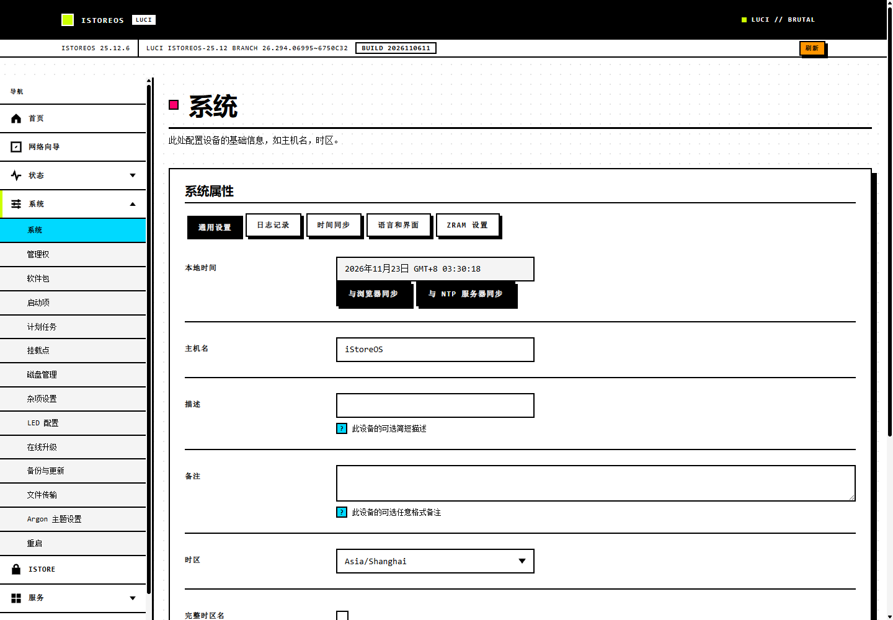
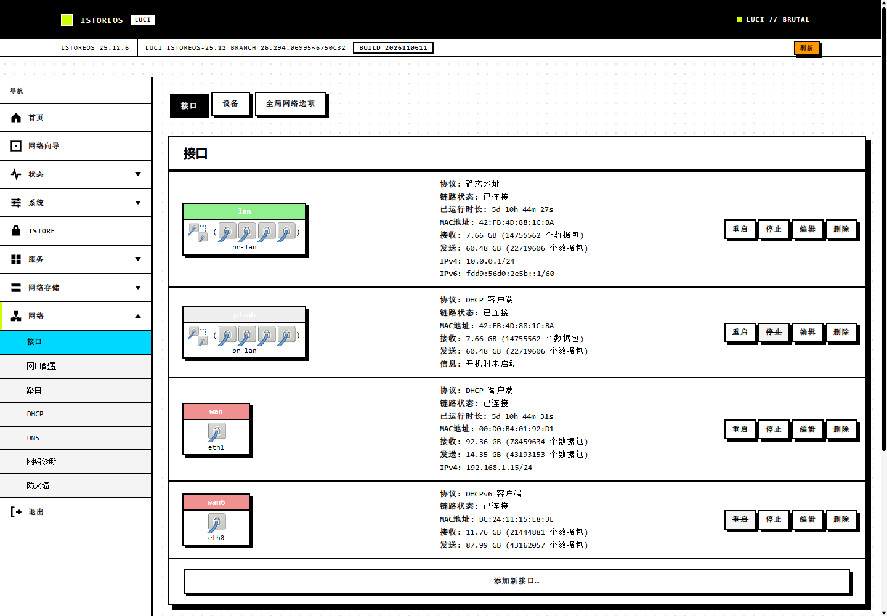
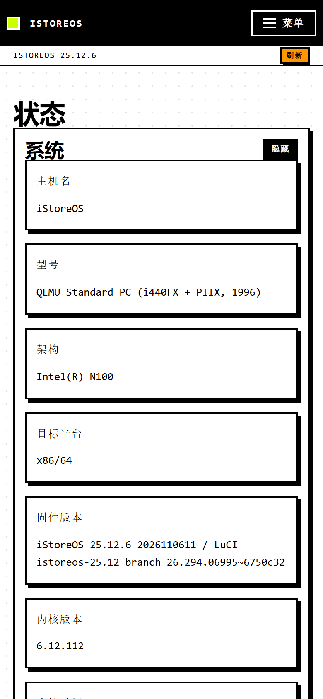
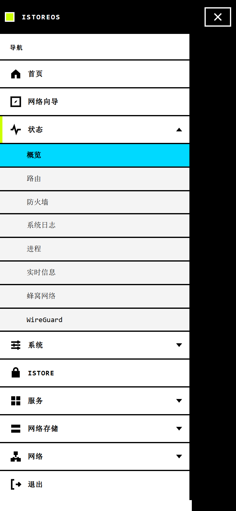

# luci-theme-brutal

新野兽派风格的 LuCI 主题：2px 纯黑描边、无模糊的 4/8px 硬阴影、零圆角，正文全等宽字体。
支持 **OpenWrt 24.10（ipk）** 与 **OpenWrt 25.12（apk）**，`PKGARCH=all`，任何架构都能装。


| 状态（侧边栏） | 系统设置 |
|---|---|
|  |  |

| 网络接口 | 登录 | 手机 | 手机抽屉 |
|---|---|---|---|
|  |  |  |  |

## 特性

- **左侧导航栏**：一级菜单带线性图标，可展开二级菜单；移动端变成抽屉，黑色遮罩盖住内容。
- **纯 CSS 变量驱动**：调色板、间距、阴影集中在 `:root` 的 `--br-*` 变量里，二改只需动一处。
- **真实的物理反馈**：hover 时阴影从 4px 涨到 10px 并向左上抬起 4px；`:active` 位移 6px、阴影归零，像被按平。
- **完整的 LuCI 组件覆盖**：表单、表格、标签页、下拉、动态列表、弹窗、UCI 差异、文件浏览器、网络接口卡片、独立登录页。
- **无外部依赖**：不加载 webfont、不请求 CDN、无 JS 框架；字体走系统等宽/无衬线栈，离线路由器上一样可用。
- **可访问性**：键盘焦点环、跳过导航链接、`prefers-reduced-motion` 降级、移动端 44px 触控目标、`aria-expanded` 菜单状态。
- **只用两种资源**：`cascade.css` + `mobile.css`，CSS 不做 csstidy 压缩（csstidy 会吃掉它不认识的现代声明）。

## 设计令牌

| Token | Value | 用途 |
|---|---|---|
| `--br-ink` | `#000000` | 所有边框、文字、硬阴影、反色块 |
| `--br-paper` | `#ffffff` | 画布与卡片 |
| `--br-slab` | `#f4f4f4` | 次级面板、禁用态 |
| `--br-pink` | `#ff006e` | 主强调、错误态、焦点环 |
| `--br-lime` | `#ccff00` | hover 填充、成功态、选中态 |
| `--br-cyan` | `#00d9ff` | 数据与次级强调 |
| `--br-orange` | `#ff9500` | 警示 |

阴影只有三档：`4px 4px 0 0 #000`、`8px 8px 0 0 #000`、hover 的 `10px 10px 0 0 #000`。没有模糊阴影，没有圆角，没有渐变（页面底纹的点阵除外），没有半透明色。

## 安装

### 从 Release 安装

每个 tag 会由 CI 上传两种格式（`PKGARCH=all`，任何架构都能装）：

```sh
# 24.10 / opkg
wget https://github.com/MinimaxFlora/luci-theme-brutal/releases/latest/download/luci-theme-brutal_1.0.0-r1_all.ipk
opkg install ./luci-theme-brutal_1.0.0-r1_all.ipk
```

```sh
# 25.12 / apk（包未签名，需 --allow-untrusted）
wget https://github.com/MinimaxFlora/luci-theme-brutal/releases/latest/download/luci-theme-brutal-1.0.0-r1.apk
apk add --allow-untrusted ./luci-theme-brutal-1.0.0-r1.apk
```

安装脚本会注册 `luci.themes.Brutal` 并在**全新安装**时把 `luci.main.mediaurlbase` 指到 `/luci-static/brutal`；升级不会覆盖你当前选中的主题。

安装后如果页面没变，切到「系统 → 系统 → 语言和界面 → 设计」确认选中 Brutal，或清一次缓存并刷新：

```sh
rm -rf /tmp/luci-indexcache.* /tmp/luci-modulecache
```

### 从源码编译

```sh
# 在 OpenWrt 源码树或 SDK 里
cd package
git clone https://github.com/MinimaxFlora/luci-theme-brutal.git
cd ..
make menuconfig   # LuCI -> Themes -> luci-theme-brutal
make package/luci-theme-brutal/compile V=s
```

产物在 `bin/packages/<arch>/base/`：24.10 是 `.ipk`，25.12 是 `.apk`。

### 装进固件

```sh
echo 'src-git brutal https://github.com/MinimaxFlora/luci-theme-brutal.git' >> feeds.conf.default
./scripts/feeds update brutal
./scripts/feeds install -a -p brutal
```

然后在 `.config` 里 `CONFIG_PACKAGE_luci-theme-brutal=y`。

## 手动验证

```sh
# 装上后确认当前主题
uci get luci.main.mediaurlbase          # /luci-static/brutal
uci show luci.themes | grep Brutal

# 确认文件和模板都到位
ls /www/luci-static/brutal/cascade.css
ls /usr/share/ucode/luci/template/themes/brutal/header.ut
```

## 目录结构

```
htdocs/luci-static/brutal/          # 样式与图标（安装到 /www/luci-static/brutal）
  cascade.css                       # 全部组件样式
  mobile.css                        # 窄屏触控微调
  icons/*.svg                       # 侧边栏线性图标（11 个，CSS mask 着色）
  logo.svg / logo_48.png
htdocs/luci-static/resources/
  menu-brutal.js                    # 侧边栏、标签页、面包屑、移动端抽屉
ucode/template/themes/brutal/
  header.ut / footer.ut / sysauth.ut
root/etc/uci-defaults/30_luci-theme-brutal
```

主题名是 `brutal`，因此资源目录、模板目录、`menu-brutal` 模块名三者必须一致；改名要一起改。侧边栏由 `menu-brutal.js` 填进 `#mainmenu`，图标名按菜单节点名映射（`status`、`system`、`services`、`network`、`nas`、`store`、`vpn`、`quickstart`、`network_guide`、`logout`），新菜单没有对应图标时回落到 `default.svg`。

登录页是独立的整页表单（`sysauth.ut`），不依赖 `ui.showModal` 和额外的视图脚本：表单直接 POST 到当前 URL，只用了 24.10 起就存在的模板变量（`fuser`、`duser`、`REQUEST_URI`），因此 24.10 与 25.12 共用同一份模板。

## 开发

```sh
# JS / shell 语法
find htdocs/luci-static/resources -name '*.js' -exec node --check {} \;
sh -n root/etc/uci-defaults/30_luci-theme-brutal

# 模板编译（需要 ucode；CI 里固定到 OpenWrt 25.12 使用的版本）
ucode -T, -s -cno-interp,dynlink=fs,dynlink=uci,dynlink=luci.core \
  -o /tmp/header.uc ucode/template/themes/brutal/header.ut
```

改完后在真机上验证：`scp` 覆盖 `/www/luci-static/brutal/`、`/www/luci-static/resources/menu-brutal.js` 和 `/usr/share/ucode/luci/template/themes/brutal/`，清掉 `/tmp/luci-indexcache.*` 与 `/tmp/luci-modulecache`，然后强制刷新页面。

## 兼容性

LuCI 的主题解析、24.10 与 25.12 的模板变量差异、ipk/apk 的 postrm 语义都记录在 [docs/COMPATIBILITY.md](docs/COMPATIBILITY.md)。

| 发行版 | 包格式 | 包管理器 | 状态 |
|---|---|---|---|
| OpenWrt 24.10.x | `.ipk` | opkg | SDK 构建验证 |
| OpenWrt 25.12.x | `.apk` | apk-tools 3 | iStoreOS 25.12.6 (x86_64) 实机安装验证 |

菜单模块填的是 `#mainmenu`（侧边栏）而不是 bootstrap 的 `#topmenu`，标签页仍在 `#tabmenu`，页脚面包屑仍在 `#modemenu`。

主题只使用 LuCI 24.10 起就存在的模板变量（`dispatched`、`media`、`version`、`blank_page`、`node.css`、`ctx.path`、`ctx.request_path`），两条分支共用同一份源码。25.12 新增的认证插件字段（`auth_fields` / `auth_html`）只在 LuCI master 上存在，这里刻意不引用，以免在 24.10/25.12 上报 undefined。

## 许可

Apache License 2.0，见 [LICENSE](LICENSE)。

---

## English

A neo-brutalist LuCI theme: 2px ink borders, hard offset shadows, zero border radius, monospace body text.
Works on OpenWrt 24.10 (ipk/opkg) and 25.12 (apk/apk-tools 3), architecture-independent (`PKGARCH=all`).
Install with `opkg install luci-theme-brutal` or `apk add luci-theme-brutal`, or clone into `package/` and build it with the SDK.
No webfonts, no CDN, no JS framework. Licensed under Apache-2.0.
