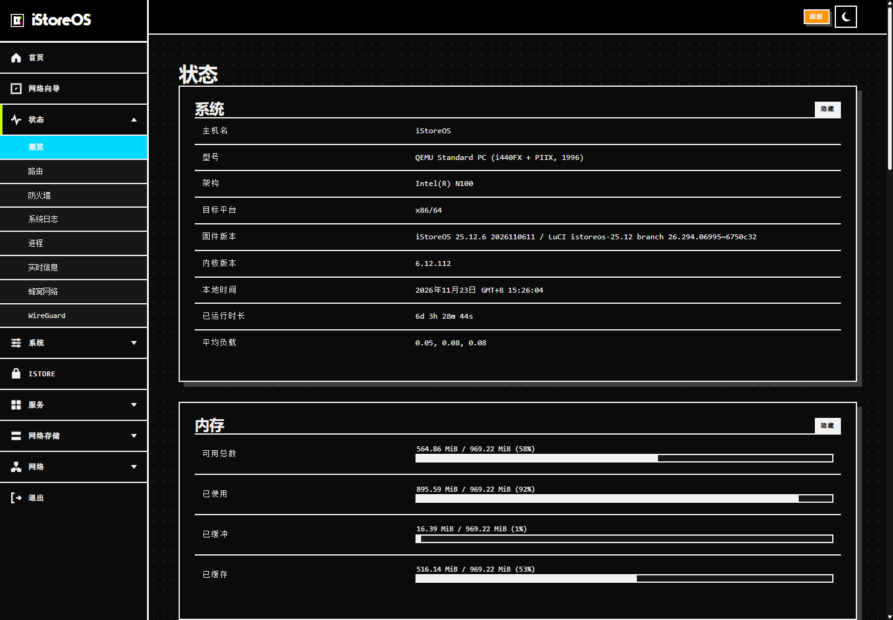

# luci-theme-brutal

新野兽派风格的 LuCI 主题：2px 纯黑描边、无模糊的 4/8px 硬阴影、零圆角、等宽正文。
布局参照 **Argon**：左侧固定导航（黑底品牌块 + 图标菜单）、内容区顶部紧凑 header、移动端抽屉。
登录页支持 Argon 式「左侧栏 / 居中」两种布局、可调毛玻璃和亮/暗色模式。
支持 **OpenWrt 24.10（ipk）** 与 **OpenWrt 25.12（apk）**，`PKGARCH=all`。


| 状态（Argon 式侧边栏） | 主题设置（luci-app-brutal-config） |
|---|---|
|  |  |

| 登录（左侧栏 + 毛玻璃） | 系统 | 手机 | 手机抽屉 |
|---|---|---|---|
|  |  |  |  |

| 暗色（概览） | 暗色登录（居中 + 毛玻璃） | 右上角主题切换 |
|---|---|---|---|
|  |  |  |

## 仓库结构

本仓库是一个包含两个软件包的 feed：

```
luci-theme-brutal/          主题：样式、模板、菜单模块、字体、壁纸
luci-app-brutal-config/     配置应用：登录页壁纸/标题
```

两个包都能单独安装；`luci-app-brutal-config` 依赖主题，反过来不依赖。

## 特性

- **主题更新检查**：设置页顶部显示当前版本，点「检查更新」直接查 GitHub 最新 Release，并给出「已是最新 / 有新版本」和发布页入口。
- **在线壁纸**：壁纸来源可选内置、必应、Unsplash、Wallhaven；内置会随机轮换 `background/` 目录里的图片或视频。
- **右上角主题切换**：header 上的方形按钮打开亮色/暗色/跟随系统菜单，带图标和选中勾，写入 `brutal.global.mode`，不再跳转设置页。
- **登录页两种布局**：`classic` 把整高面板贴在左边缘（Argon 风格），`centered` 把卡片浮在页面中间；两者都可以开毛玻璃（`backdrop-filter`），模糊半径和不透明度可调，暗色面板可单独设置。
- **亮色 / 暗色模式**：`normal` 跟随系统，`light` / `dark` 固定；暗色是反相的新野兽派配色（近黑纸面、白色描边、灰色硬阴影），不是简单的反色滤镜。
- **Argon 式布局**：左侧导航顶部是黑底品牌块，下面是带图标的一级菜单和可展开的二级菜单；内容区顶部有独立的黑色 header（指示器 + 主题设置入口），页面滚动时 header 常驻。移动端侧栏变成抽屉，黑幕遮罩 + `Esc` 关闭。
- **没有多余的状态条**：header 不再堆主机名、版本号和 `LuCI // BRUTAL` 标签；这些信息在「状态 → 概览」里。
- **字体随包分发**：`GoogleSans-Regular.woff2`（正文/标题）与 `TypoGraphica.woff2`（品牌和登录大标题）放在 `htdocs/luci-static/brutal/fonts/`，`@font-face` 本地加载，离线路由器可用，不请求任何 CDN。
- **登录壁纸**：默认使用包内 `img/bg1.webp`，可在「系统 → Brutal 主题」里关闭、换成本地路径或 `https://` 图片，并修改登录卡上的大标题。
- **纯 CSS 变量驱动**：调色板、间距、阴影集中在 `:root` 的 `--br-*` 变量里，二改只需动一处。
- **真实的物理反馈**：hover 时阴影从 4px 涨到 10px 并向左上抬起 4px；`:active` 位移 6px、阴影归零。
- **完整的 LuCI 组件覆盖**：表单、表格、标签页、下拉（含「保存并应用」分裂按钮）、动态列表、弹窗、UCI 差异、文件浏览器、网络接口卡片、独立登录页。
- **可访问性**：键盘焦点环、跳过导航链接、`prefers-reduced-motion` 降级、移动端 44px 触控目标、`aria-expanded` 菜单状态、登录页 `autocomplete` 提示。
- CSS 不做 csstidy 压缩（csstidy 会吃掉它不认识的现代声明）。

## 设计令牌

| Token | Value | 用途 |
|---|---|---|
| `--br-ink` | `#000000` | 所有边框、文字、硬阴影、反色块 |
| `--br-paper` | `#ffffff` | 画布与卡片 |
| `--br-slab` | `#f4f4f4` | 次级面板、子菜单底 |
| `--br-pink` | `#ff006e` | 主强调、错误态、焦点环 |
| `--br-lime` | `#ccff00` | hover 填充、成功态、选中态 |
| `--br-cyan` | `#00d9ff` | 当前子菜单、数据强调 |
| `--br-orange` | `#ff9500` | 警示、保存中指示器 |

阴影只有三档：`4px 4px 0 0 #000`、`8px 8px 0 0 #000`、hover 的 `10px 10px 0 0 #000`。没有圆角，没有渐变（页面底纹的点阵除外），没有半透明色。

字体：标题 `Google Sans` 900（中文回落到 `PingFang SC` / `Microsoft YaHei`），正文与标签等宽栈；品牌与登录大标题用 `TypoGraphica`。

## 安装

### 从 Release 安装

每个 tag 的 Release 会同时提供 24.10 的 ipk 与 25.12 的 apk（主题、配置应用、中文翻译各一个）。

```sh
# 25.12 / apk（包未签名，需 --allow-untrusted）
wget https://github.com/MinimaxFlora/luci-theme-brutal/releases/latest/download/luci-theme-brutal-1.3.1-r3.apk
wget https://github.com/MinimaxFlora/luci-theme-brutal/releases/latest/download/luci-app-brutal-config-1.3.1-r3.apk
wget https://github.com/MinimaxFlora/luci-theme-brutal/releases/latest/download/luci-i18n-brutal-config-zh-cn-1.3.1-r3.apk
apk add --allow-untrusted ./luci-theme-brutal-1.3.1-r3.apk \
  ./luci-app-brutal-config-1.3.1-r3.apk ./luci-i18n-brutal-config-zh-cn-1.3.1-r3.apk
```

```sh
# 24.10 / opkg
wget https://github.com/MinimaxFlora/luci-theme-brutal/releases/latest/download/luci-theme-brutal_1.3.1-r3_all.ipk
wget https://github.com/MinimaxFlora/luci-theme-brutal/releases/latest/download/luci-app-brutal-config_1.3.1-r3_all.ipk
wget https://github.com/MinimaxFlora/luci-theme-brutal/releases/latest/download/luci-i18n-brutal-config-zh-cn_v1.3.1_all.ipk
opkg install ./luci-theme-brutal_1.3.1-r3_all.ipk \
  ./luci-app-brutal-config_1.3.1-r3_all.ipk ./luci-i18n-brutal-config-zh-cn_v1.3.1_all.ipk
```

主题的安装脚本会注册 `luci.themes.Brutal`，并在**全新安装**时把 `luci.main.mediaurlbase` 指到 `/luci-static/brutal`；升级不会覆盖你当前选中的主题。装完如果页面没变，清一次缓存并强制刷新：

```sh
rm -rf /tmp/luci-indexcache.* /tmp/luci-modulecache
```

### 从源码编译

```sh
cd package
git clone https://github.com/MinimaxFlora/luci-theme-brutal.git
cd ..
make menuconfig   # LuCI -> Themes -> luci-theme-brutal
                  # LuCI -> Applications -> luci-app-brutal-config
make package/luci-theme-brutal/compile package/luci-app-brutal-config/compile V=s
```

产物在 `bin/packages/<arch>/base/`：24.10 是 `.ipk`，25.12 是 `.apk`。

### 装进固件

```sh
echo 'src-git brutal https://github.com/MinimaxFlora/luci-theme-brutal.git' >> feeds.conf.default
./scripts/feeds update brutal
./scripts/feeds install -a -p brutal
```

然后在 `.config` 里 `CONFIG_PACKAGE_luci-theme-brutal=y` 和 `CONFIG_PACKAGE_luci-app-brutal-config=y`。

## 主题设置

安装 `luci-app-brutal-config` 后，菜单「系统 → Brutal 主题」，或者点 header 右侧的滑杆图标。

| 选项 | UCI | 默认值 | 说明 |
|---|---|---|---|
| 登录页布局 | `brutal.global.login_style` | `classic` | `classic` 左侧栏；`centered` 居中卡片 |
| 主题模式 | `brutal.global.mode` | `normal` | `normal` 跟随系统；`light` / `dark` 固定 |
| 强调色 | `brutal.global.accent` | `#00d9ff` | 任意 HEX，默认电光青；也可用 `pink` / `lime` / `orange` |
| 毛玻璃面板 | `brutal.global.glass` | `1` | 关闭后登录卡片恢复纯色纸面 |
| 模糊半径 | `brutal.global.blur` | `10` | 0–100 px，只在毛玻璃开启时生效 |
| 面板不透明度 | `brutal.global.transparency` | `0.5` | 0–1，1 表示完全遮住壁纸 |
| 暗色面板 | `brutal.global.dark_glass_mode` | `inherit` | `inherit` 复用亮色值；`custom` 单独设置 |
| 暗色模糊 | `brutal.global.blur_dark` | `10` | `dark_glass_mode=custom` 时生效 |
| 暗色不透明度 | `brutal.global.transparency_dark` | `0.5` | `dark_glass_mode=custom` 时生效 |
| 壁纸来源 | `brutal.global.online_wallpaper` | `none` | `none` 内置 / `bing` / `unsplash` / `wallhaven` |
| Unsplash 密钥 | `brutal.global.use_api_key` | 空 | 使用 Unsplash 时必填 |

旧版本的 `brutal.login.*` 仍然兼容；安装 1.3.1 的配置应用时会自动把旧值迁移到 `brutal.global.*`。

登录页不再有单独的标题/壁纸设置块（Argon 也没有）：左侧面板顶部固定显示「Logo + 主机名」，壁纸由「壁纸来源」和背景目录控制。

设置页还提供：

- **登录页预览图**：切换 classic / centered 时实时更新布局示意。
- **品牌资源**：上传 PNG 网站图标（必须正方形）和登录页 Logo，支持「同时用于两处」和一键重置；文件存在 `/www/luci-static/brutal/branding/`。
- **背景目录**：显示 `/www` 可用空间，上传 gif/jpg/png/webp/mp4/webm，列出文件名/修改时间/大小并单独删除；文件存在 `/www/luci-static/brutal/background/`。

配置文件是 `/etc/config/brutal`，作为 conffile 保存，升级保留你的修改。主题模板每次渲染时用 `uci` 读取它；没装配置应用时按默认值显示壁纸。

## 手动验证

```sh
# 当前主题
uci get luci.main.mediaurlbase          # /luci-static/brutal
uci show luci.themes | grep Brutal

# 关键文件
ls /www/luci-static/brutal/{cascade.css,img/bg1.webp,fonts/GoogleSans-Regular.woff2}
ls /usr/share/ucode/luci/template/themes/brutal/{header.ut,footer.ut,sysauth.ut}
ls /usr/share/luci/menu.d/luci-app-brutal-config.json

# 登录页配置
uci show brutal
```

## 目录结构

```
luci-theme-brutal/
  htdocs/luci-static/brutal/
    cascade.css                 全部样式（含 @font-face 与 Argon 式布局）
    mobile.css                  窄屏触控微调
    fonts/                      GoogleSans-Regular.woff2、TypoGraphica.woff2
    img/bg1.webp                默认登录壁纸
    icons/*.svg                 侧栏图标（12 个，CSS mask 着色）
    logo.svg / logo_48.png
  htdocs/luci-static/resources/
    menu-brutal.js              侧栏、标签页、面包屑、移动端抽屉
  ucode/template/themes/brutal/
    header.ut / footer.ut / sysauth.ut
  root/etc/uci-defaults/30_luci-theme-brutal

luci-app-brutal-config/
  htdocs/luci-static/resources/view/brutal/config.js
  root/etc/config/brutal
  root/usr/share/luci/menu.d/luci-app-brutal-config.json
  root/usr/share/rpcd/acl.d/luci-app-brutal-config.json
  po/zh_Hans/brutal-config.po
```

主题名是 `brutal`，因此资源目录、模板目录、`menu-brutal` 模块名三者必须一致；改名要一起改。侧边栏由 `menu-brutal.js` 填进 `#mainmenu`（品牌块保留在 `aside` 里，模块只替换 `.sidebar-nav`），图标按菜单节点名映射（`status`、`system`、`services`、`network`、`nas`、`store`、`vpn`、`quickstart`、`network_guide`、`brutal`、`logout`），未知节点回落到 `default.svg`。

登录页是独立的整页表单（`sysauth.ut`），不依赖 `ui.showModal`：表单直接 POST 到当前 URL，壁纸层是 `position: fixed` 的 `.login-bg`，卡片始终不透明，保证复杂图片上的可读性。

## 开发

```sh
# 静态检查：shell/JS 语法、主题接线、CSS 契约、模板编译、配置应用接线
sh .github/scripts/check_theme.sh

# 需要 ucode；没有就指定自编译的二进制
UCODE_BIN=/path/to/ucode sh .github/scripts/check_theme.sh
```

改完后在真机上验证：`scp` 覆盖 `/www/luci-static/brutal/`、`/www/luci-static/resources/menu-brutal.js` 和 `/usr/share/ucode/luci/template/themes/brutal/`，清掉 `/tmp/luci-indexcache.*` 与 `/tmp/luci-modulecache`，然后强制刷新页面。

## 兼容性

LuCI 的主题解析、24.10 与 25.12 的模板变量差异、ipk/apk 的 postrm 语义都记录在 [docs/COMPATIBILITY.md](docs/COMPATIBILITY.md)。

| 发行版 | 包格式 | 包管理器 | 状态 |
|---|---|---|---|
| OpenWrt 24.10.x | `.ipk` | opkg | SDK 构建验证 |
| OpenWrt 25.12.x | `.apk` | apk-tools 3 | iStoreOS 25.12.6 (x86_64) 实机安装/升级/设置页/亮暗色/双布局验证 |

菜单模块填的是 `#mainmenu`（侧边栏）而不是 bootstrap 的 `#topmenu`，标签页仍在 `#tabmenu`，页脚面包屑仍在 `#modemenu`。

主题只使用 LuCI 24.10 起就存在的模板变量（`dispatched`、`media`、`version`、`blank_page`、`node.css`、`ctx.path`、`ctx.request_path`），两条分支共用同一份源码。登录页用 `import { cursor } from 'uci'` 读配置，这个模块在两条分支的模板运行环境里都有。

## 字体与壁纸

- `GoogleSans-Regular.woff2`、`TypoGraphica.woff2` 取自 [luci-theme-argon](https://github.com/jerrykuku/luci-theme-argon) 的 `htdocs/luci-static/argon/fonts/`，按该仓库的分发方式随主题一起打包；商用或再分发前请自行确认字体授权。
- `img/bg1.webp` 由用户提供的图片转换而来（WebP，质量 82），仅作为默认登录壁纸。

## 许可

Apache License 2.0，见 [LICENSE](LICENSE)。

---

## English

A neo-brutalist LuCI theme with an Argon-style layout: a fixed sidebar with a brand block and icon menu, a compact top header, and a drawer on mobile.
2px ink borders, zero-blur hard shadows, zero border radius, monospace body text.
Ships Google Sans and TypoGraphica locally (no CDN), plus a login wallpaper and a separate `luci-app-brutal-config` settings app.
The settings page includes update checking, login-layout previews, a HEX accent picker, online wallpaper sources, branding uploads and a managed background directory.
The login page supports a classic side panel or a centered card, an optional frosted panel (blur + opacity), and light/dark modes.
Works on OpenWrt 24.10 (ipk/opkg) and 25.12 (apk/apk-tools 3), architecture-independent (`PKGARCH=all`).
Licensed under Apache-2.0.
