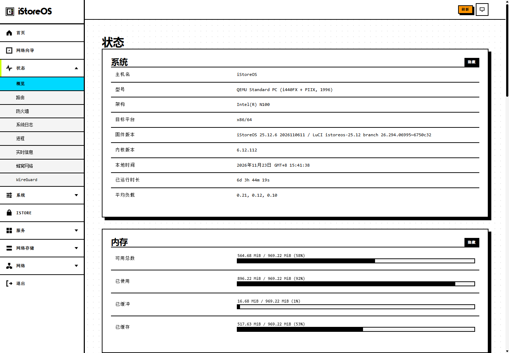
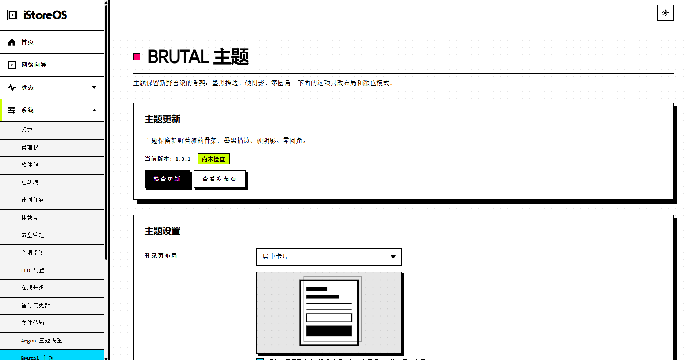
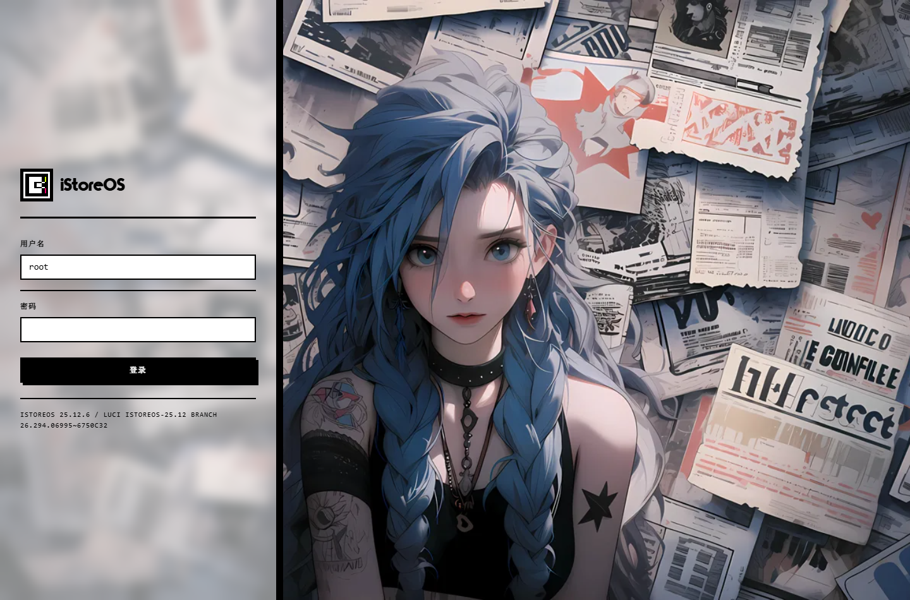
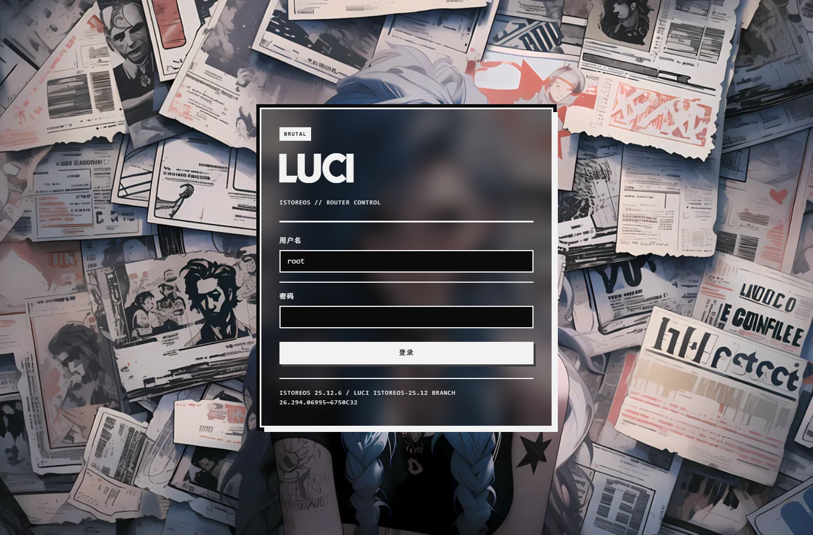
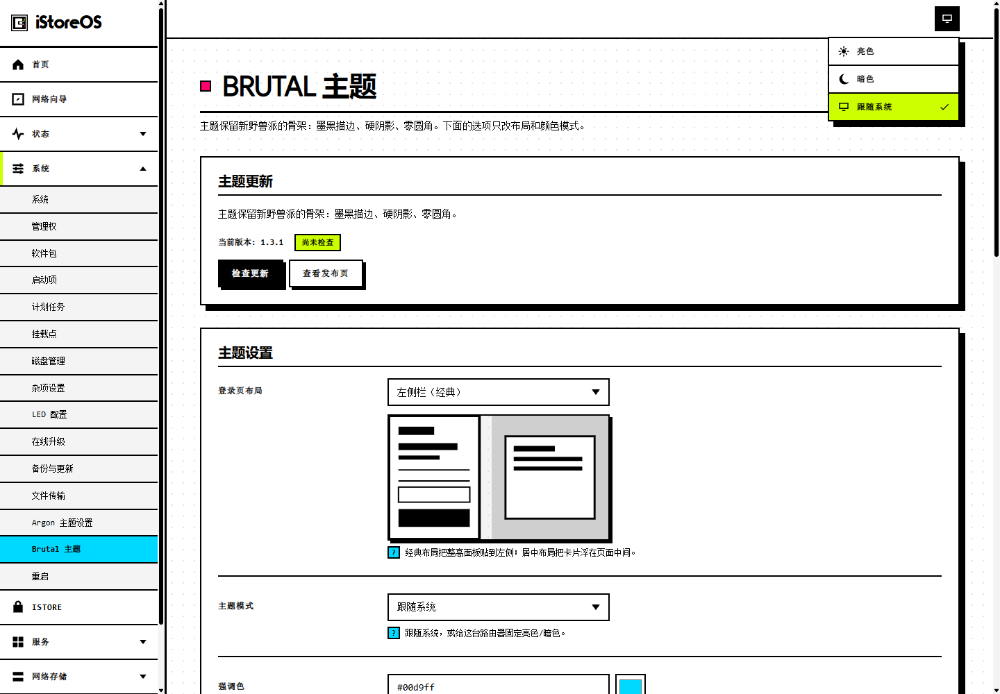

# luci-theme-brutal

**A neo-brutalist LuCI theme for OpenWrt**, with an Argon-style layout and settings page.

2px ink outlines. Zero-blur hard shadows. Zero rounded corners. Monospace body text.
Built to feel like a physical interface: every card, button and menu is a solid slab
that lifts on hover and gets pressed flat on click.

[](LICENSE)
[](https://github.com/MinimaxFlora/luci-theme-brutal/releases)
[](https://github.com/MinimaxFlora/luci-theme-brutal/releases)
[](https://github.com/MinimaxFlora/luci-theme-brutal/issues/new)

**English** · [简体中文](README_ZH.md)



## Features

- **Neo-brutalist design** — 2px pure-black borders, 4/8/10px hard shadows with no blur, square corners, dotted paper background, one high-saturation accent per role.
- **Argon-style navigation** — fixed left sidebar with a brand block, icon for every top-level menu and expandable submenus; drawer plus mask on mobile.
- **Two login layouts** — `classic` (full-height panel on the left edge) and `centered` (card floating in the middle), both with optional frosted glass.
- **Light / dark / follow system** — switch from the header or from the settings page; the choice also applies to the login page.
- **Theme settings app** — `luci-app-brutal-config` provides update checks, login-layout previews, accent color, transparency/blur, wallpaper source, favicon and login logo uploads, and a managed background directory.
- **Background directory** — drop images or videos into `/www/luci-static/brutal/background/`; the login page picks one at random. Built-in wallpaper falls back to `img/bg1.webp`.
- **Online wallpapers** — Bing, Unsplash and Wallhaven, with an API key field for Unsplash.
- **Custom branding** — upload a square PNG favicon and a login logo (16–1024 px per side, max 1 MiB); both default to the bundled logo.
- **Offline assets** — Google Sans and TypoGraphica are shipped in the package; no CDN and no external font requests.
- **Both package formats** — OpenWrt 24.10 (`opkg` / `.ipk`) and 25.12 (`apk` / apk-tools 3), `PKGARCH=all`.

## Install

Download the format that matches your firmware from [Releases](https://github.com/MinimaxFlora/luci-theme-brutal/releases).
The release contains the theme, the settings app and the Simplified Chinese translation.

| Package manager | Theme package | Install |
| --- | --- | --- |
| `opkg` | `.ipk` | `opkg install ./luci-theme-brutal_*_all.ipk` |
| APK v3 (`apk-tools 3.x`) | `.apk` | `apk add --allow-untrusted ./luci-theme-brutal-*.apk` |

Install the matching `luci-app-brutal-config` and `luci-i18n-brutal-config-zh-cn` packages from the same release and in the same format.

Then select **Brutal** under **System → System → Language and Interface → Design**.

If the page still looks like Bootstrap, clear the LuCI caches and force-reload:

```sh
rm -rf /tmp/luci-indexcache.* /tmp/luci-modulecache
```

> APK v2 cannot read these packages. Keep the package manager that ships with your firmware.

## Customize

Open **System → Brutal Theme**, or click the sliders button in the header.

| Option | UCI | Default | Notes |
| --- | --- | --- | --- |
| Login layout | `brutal.global.login_style` | `classic` | `classic` left panel, `centered` card |
| Theme mode | `brutal.global.mode` | `normal` | `normal` follows the system; `light` / `dark` fixed |
| Accent color | `brutal.global.accent` | `#00d9ff` | Any HEX value |
| Frosted panel | `brutal.global.glass` | `1` | Disable for a solid paper panel |
| Blur | `brutal.global.blur` | `10` | 0–100 px |
| Panel opacity | `brutal.global.transparency` | `0.5` | 0–1 |
| Dark panel | `brutal.global.dark_glass_mode` | `inherit` | `custom` to override the dark values |
| Dark blur / opacity | `brutal.global.blur_dark` / `transparency_dark` | `10` / `0.5` | Used when `dark_glass_mode=custom` |
| Wallpaper source | `brutal.global.online_wallpaper` | `none` | `none` local, `bing`, `unsplash`, `wallhaven` |
| Unsplash key | `brutal.global.use_api_key` | empty | Required for Unsplash |

The settings page also provides:

- **Login layout previews** that update when you switch between classic and centered.
- **Branding** — favicon and login logo, with “use for both” and reset; stored in `/www/luci-static/brutal/branding/`.
- **Backgrounds** — upload gif/jpg/png/webp/mp4/webm, list files with size and modification time, delete individually; stored in `/www/luci-static/brutal/background/`.
- **Save current settings** below the dark panel; the page footer has no duplicate save bar.

The configuration lives in `/etc/config/brutal` as a conffile, so upgrades keep your changes.

## Theme updates

The settings page shows the installed version, checks the latest GitHub release, and links to the release page. Installation stays with the firmware's native package manager; the theme does not run package operations by itself.

## Compatibility

| Release | Format | Package manager | Status |
| --- | --- | --- | --- |
| OpenWrt 24.10.x | `.ipk` | `opkg` | SDK build verified |
| OpenWrt 25.12.x | `.apk` | apk-tools 3 | Installed and exercised on iStoreOS 25.12.6 (x86_64): install, upgrade, settings, light/dark, both login layouts |

The same source tree targets both branches. Details about template variables and package semantics are in [docs/COMPATIBILITY.md](docs/COMPATIBILITY.md).

## Build

As a feed:

```sh
echo 'src-git brutal https://github.com/MinimaxFlora/luci-theme-brutal.git' >> feeds.conf.default
./scripts/feeds update brutal
./scripts/feeds install -a -p brutal
```

Select `CONFIG_PACKAGE_luci-theme-brutal=y` and `CONFIG_PACKAGE_luci-app-brutal-config=y`, then build normally.
Artifacts land in `bin/packages/<arch>/base/`: `.ipk` on 24.10, `.apk` on 25.12.

Static checks (shell, JavaScript, CSS contract, ucode templates):

```sh
sh .github/scripts/check_theme.sh
```

## Screenshots

| Settings | Login |
| --- | --- |
|  |  |

| Dark overview | Dark login | Header switch |
| --- | --- | --- |
|  |  |  |

## Credits

Brutal borrows heavily from **[luci-theme-argon](https://github.com/jerrykuku/luci-theme-argon)** by
[jerrykuku](https://github.com/jerrykuku): the sidebar structure, the settings page layout,
the two login layouts, the wallpaper directory and the branding workflow are all modelled on it.
The bundled **Google Sans** and **TypoGraphica** webfonts also come from Argon's
`htdocs/luci-static/argon/fonts/`; check the font licenses before commercial redistribution.

The theme is built on LuCI's Bootstrap base classes and the standard OpenWrt theme API.

## License

Apache License 2.0 — see [LICENSE](LICENSE).

Copyright 2026 MinimaxFlora
