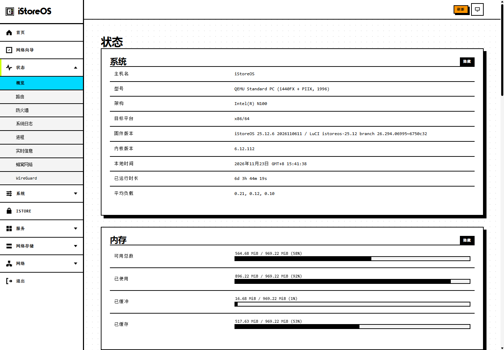
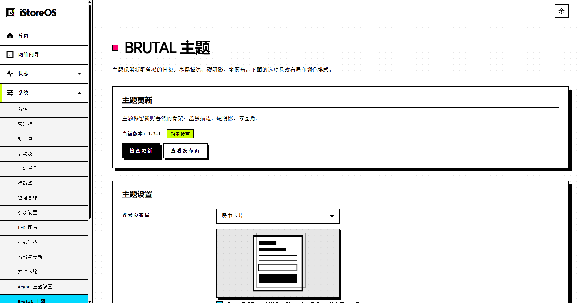
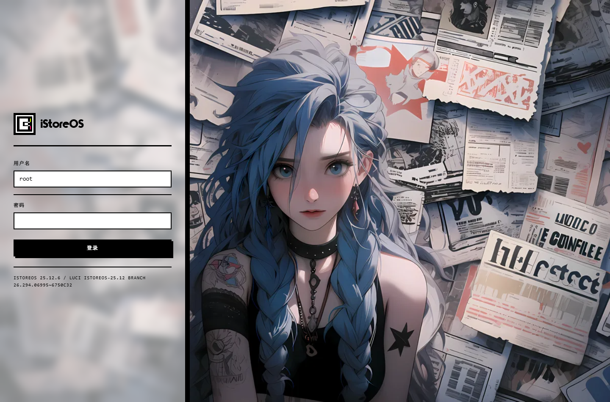
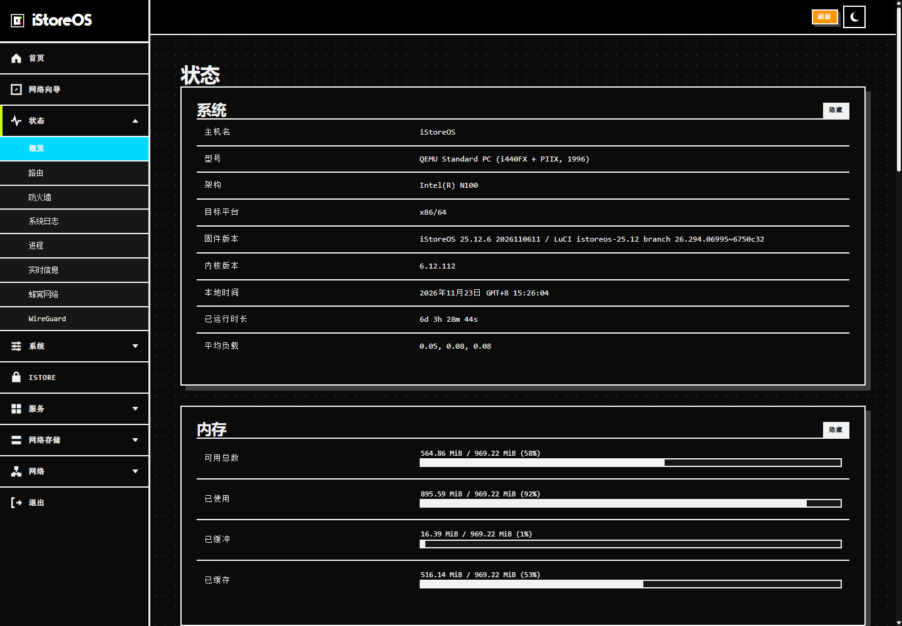
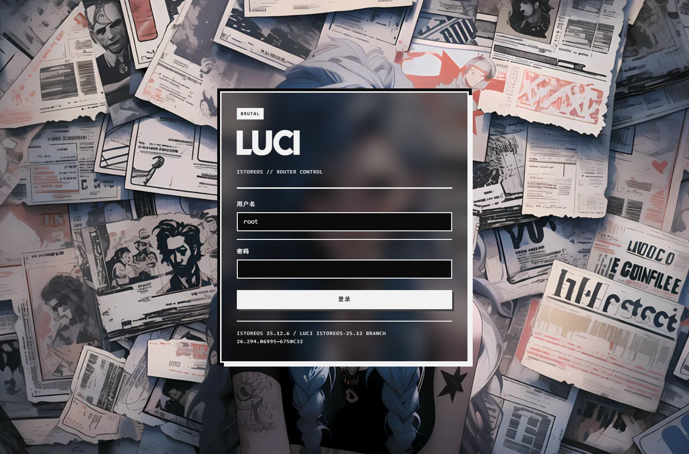
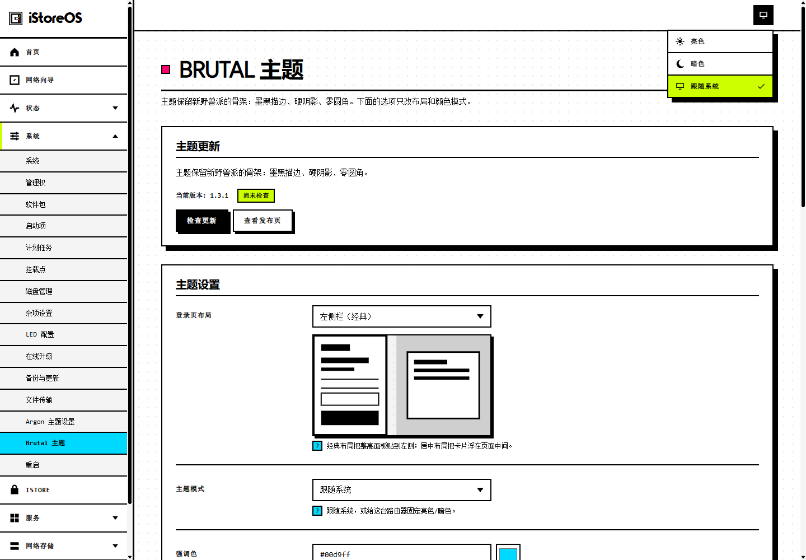

# luci-theme-brutal

**新野兽派风格的 OpenWrt LuCI 主题**，布局与设置页对齐 Argon。

2px 纯黑描边、无模糊的 4/8/10px 硬阴影、零圆角、等宽正文。
界面由一块块「压不扁的实体」组成：hover 时抬起，按下时位移等于阴影偏移量，像被手掌压平。

[](LICENSE)
[](https://github.com/MinimaxFlora/luci-theme-brutal/releases)
[](https://github.com/MinimaxFlora/luci-theme-brutal/releases)
[](https://github.com/MinimaxFlora/luci-theme-brutal/issues/new)

[English](README.md) · **简体中文**



## 特性

- **新野兽派视觉**——2px 纯黑描边、4/8/10px 无模糊硬阴影、零圆角、点阵纸面背景，每支强调色只承担一个固定职能。
- **Argon 式导航**——左侧固定侧栏：黑底品牌块、每个一级菜单带图标、可展开二级菜单；移动端变抽屉，带遮罩与 `Esc` 关闭。
- **两套登录界面**——`classic` 左侧整高面板、`centered` 居中卡片，都可以开毛玻璃。
- **亮色 / 暗色 / 跟随系统**——右上角图标按钮或设置页切换，登录页同步生效。
- **主题设置应用**——`luci-app-brutal-config` 提供更新检查、登录布局预览、强调色、透明度/模糊、壁纸来源、网站图标与登录 Logo 上传、背景目录管理。
- **背景目录**——把图片或视频放进 `/www/luci-static/brutal/background/`，登录页随机取一张；没有文件时回退到内置 `img/bg1.webp`。
- **在线壁纸**——必应、Unsplash、Wallhaven；Unsplash 需要填 API Access Key。
- **自定义图标**——PNG 网站图标（必须正方形）和登录 Logo，每边 16–1024 像素、最大 1 MiB；两处默认都使用内置 Logo。
- **资源离线**——Google Sans 与 TypoGraphica 随包分发，不请求 CDN，离线路由器也能正常显示。
- **双包格式**——OpenWrt 24.10（`opkg` / `.ipk`）与 25.12（`apk` / apk-tools 3），`PKGARCH=all`。

## 安装

前往 [Releases](https://github.com/MinimaxFlora/luci-theme-brutal/releases) 下载与固件原生包管理器匹配的格式。
每次发行包含主题、设置应用和简体中文翻译三个包。

| 包管理器 | 主题包 | 安装命令 |
| --- | --- | --- |
| `opkg` | `.ipk` | `opkg install ./luci-theme-brutal_*_all.ipk` |
| APK v3（`apk-tools 3.x`） | `.apk` | `apk add --allow-untrusted ./luci-theme-brutal-*.apk` |

再从同一次发行中安装格式一致的 `luci-app-brutal-config` 和 `luci-i18n-brutal-config-zh-cn`。

然后在 **系统 → 系统 → 语言和界面 → 主题** 中选择 **Brutal**。

如果装完页面还是 Bootstrap，清一次 LuCI 缓存并强制刷新：

```sh
rm -rf /tmp/luci-indexcache.* /tmp/luci-modulecache
```

> APK v2 无法读取本项目的安装包，请沿用固件自带的包管理器。

## 自定义

打开 **系统 → Brutal 主题**，或点 header 右侧的滑杆按钮。

| 选项 | UCI | 默认值 | 说明 |
| --- | --- | --- | --- |
| 登录页布局 | `brutal.global.login_style` | `classic` | `classic` 左侧栏；`centered` 居中卡片 |
| 主题模式 | `brutal.global.mode` | `normal` | `normal` 跟随系统；`light` / `dark` 固定 |
| 强调色 | `brutal.global.accent` | `#00d9ff` | 任意 HEX |
| 毛玻璃面板 | `brutal.global.glass` | `1` | 关闭后登录卡片为纯色纸面 |
| 模糊半径 | `brutal.global.blur` | `10` | 0–100 px |
| 面板不透明度 | `brutal.global.transparency` | `0.5` | 0–1 |
| 暗色面板 | `brutal.global.dark_glass_mode` | `inherit` | `custom` 时单独设置暗色值 |
| 暗色模糊 / 不透明度 | `brutal.global.blur_dark` / `transparency_dark` | `10` / `0.5` | `dark_glass_mode=custom` 时生效 |
| 壁纸来源 | `brutal.global.online_wallpaper` | `none` | `none` 本地目录，`bing`、`unsplash`、`wallhaven` |
| Unsplash 密钥 | `brutal.global.use_api_key` | 空 | 使用 Unsplash 时必填 |

设置页还提供：

- **登录布局预览**：切换 classic / centered 时实时更新示意图。
- **品牌资源**：网站图标与登录页 Logo 上传，支持「同时用于两处」和重置；保存在 `/www/luci-static/brutal/branding/`。
- **背景目录**：上传 gif/jpg/png/webp/mp4/webm，显示文件名、修改时间、大小并可单独删除；保存在 `/www/luci-static/brutal/background/`。
- **保存当前设置**：按钮在暗色面板下方，页面底部不再重复一条保存栏。

配置文件是 `/etc/config/brutal`（conffile），升级会保留你的修改。

## 主题更新

设置页显示当前版本，点击「检查更新」查询 GitHub 最新 Release，并给出「已是最新 / 有新版本」和发布页入口。安装仍走固件自带的 APK 或 OPKG，主题本身不执行包管理操作。

## 兼容性

| 发行版 | 包格式 | 包管理器 | 状态 |
| --- | --- | --- | --- |
| OpenWrt 24.10.x | `.ipk` | `opkg` | SDK 构建验证 |
| OpenWrt 25.12.x | `.apk` | apk-tools 3 | 已在 iStoreOS 25.12.6（x86_64）实测：安装、升级、设置页、亮暗色、双登录布局 |

同一份源码同时面向两条分支。模板变量与包语义的差异记录在 [docs/COMPATIBILITY.md](docs/COMPATIBILITY.md)。

## 构建

作为 feed：

```sh
echo 'src-git brutal https://github.com/MinimaxFlora/luci-theme-brutal.git' >> feeds.conf.default
./scripts/feeds update brutal
./scripts/feeds install -a -p brutal
```

在 `.config` 中选择 `CONFIG_PACKAGE_luci-theme-brutal=y` 和 `CONFIG_PACKAGE_luci-app-brutal-config=y`，然后正常编译。
产物在 `bin/packages/<arch>/base/`：24.10 为 `.ipk`，25.12 为 `.apk`。

静态检查（shell、JavaScript、CSS 契约、ucode 模板）：

```sh
sh .github/scripts/check_theme.sh
```

## 效果展示

| 主题设置 | 登录页 |
| --- | --- |
|  |  |

| 暗色概览 | 暗色登录 | 右上角切换 |
| --- | --- | --- |
|  |  |  |

## 鸣谢

本项目的布局与功能大量借鉴 **[luci-theme-argon](https://github.com/jerrykuku/luci-theme-argon)**（作者 [jerrykuku](https://github.com/jerrykuku)）：
侧栏结构、设置页分区、两套登录布局、背景目录和自定义图标流程都以它为参照实现。
包内的 **Google Sans**、**TypoGraphica** 字体同样来自 Argon 的 `htdocs/luci-static/argon/fonts/`；商用或再分发前请自行确认字体授权。

主题基于 LuCI 的 Bootstrap 基础类和 OpenWrt 官方主题接口编写。

## 许可

Apache License 2.0，见 [LICENSE](LICENSE)。

Copyright 2026 MinimaxFlora <zj18139624826@gmail.com>
